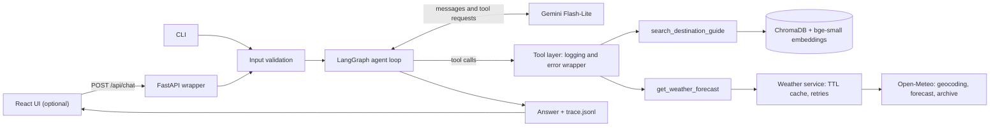

# 🧳 TripMate: an agentic travel assistant

TripMate answers natural-language travel questions (visas, weather, packing, customs, safety) for **Tokyo, Reykjavik, Bangkok and Barcelona**.

The LLM decides **per query** which tools to call, with which arguments, and in what order. There is no keyword routing and no fixed script. Every decision, tool call, result and error is logged with a per-request `trace_id`, and the optional web UI shows that full trace next to each answer.

| | |
|---|---|
| **Loom walkthrough** | `https://www.loom.com/share/a0856f2057c84b7b9ed83f613ee3cac2` |
| **Repository** | `https://github.com/dhruv02072004/tripmate.git` |
| **Stack** | Python 3.10+, LangGraph, LangChain, Gemini Flash-Lite, ChromaDB, BAAI/bge-small-en-v1.5, Open-Meteo, FastAPI, React (Vite) |
| **Tests** | 25 offline (no API key needed) and 5 live routing evals against the real model |

---

## Contents

1. [What it does](#1-what-it-does)
2. [Requirements checklist](#2-requirements-checklist)
3. [Quick start](#3-quick-start)
4. [Architecture](#4-architecture)
5. [Tool schemas (as given to the LLM)](#5-tool-schemas-as-given-to-the-llm)
6. [Example runs](#6-example-runs)
7. [Web UI and full trace panel](#7-web-ui-and-full-trace-panel)
8. [Design decisions](#8-design-decisions)
9. [Error handling](#9-error-handling)
10. [Logging and observability](#10-logging-and-observability)
11. [Testing](#11-testing)
12. [RAG threshold calibration](#12-rag-threshold-calibration)
13. [Scalability considerations](#13-scalability-considerations)
14. [Known limitations](#14-known-limitations)
15. [Future improvements](#15-future-improvements)
16. [Project structure](#16-project-structure)

---

## 1. What it does

| Question | What the agent does |
|---|---|
| "Do I need a visa for Tokyo? I'm a US citizen." | Searches the destination guide only |
| "What's the weather like in Bangkok in July?" | Calls the weather tool only |
| "What should I pack for Reykjavik in January?" | Calls **both tools in parallel** and merges the results |
| "I want to see the Northern Lights in Iceland. What should I pack?" | **Chains** the tools: the guide says December to February is the season, so the weather call uses December |
| "Can you book my flight to Barcelona?" | Calls no tool, says it cannot book, and offers what it can do |
| "Tell me about Paris customs." | The tool returns an unsupported-destination marker and the agent explains honestly |
| "What cultural practices should I follow at temples?" (no city) | Asks one clarifying question instead of guessing |

---

## 2. Requirements checklist

| Requirement | Where it lives |
|---|---|
| Agent decides tools dynamically (no keyword routing) | `tripmate/agent/graph.py`, proven by `tests/test_live_routing.py` |
| Correct order for dependent calls | Northern Lights chain, see example C |
| Single coherent synthesized answer | Final `agent` node after tool results |
| Visible reasoning trace | `reason` argument on every tool call, JSON logs, `-v` mode, UI trace panel |
| RAG tool `search_destination_guide` | `tripmate/rag/`, `tripmate/tools/factory.py` |
| Weather tool `get_weather_forecast` | `tripmate/services/weather.py` (real Open-Meteo API) |
| Multi-tool query (packing) | Examples B and C |
| Scope awareness | System prompt rules, example D |
| Layered design | Services, tools, agent and foundations are separate packages (see [section 16](#16-project-structure)) |
| Config via environment | `tripmate/config.py` (pydantic-settings), `.env.example` |
| Structured logging | `tripmate/logging_setup.py`, `logs/trace.jsonl` |
| Exception handling around tools | `@traced` decorator plus typed error payloads |
| Input validation | `tripmate/validation.py`, runs before any LLM call |
| Unit, routing and integration tests | `tests/` (see [section 11](#11-testing)) |
| Scalability discussion | [Section 13](#13-scalability-considerations) |

---

## 3. Quick start

### Prerequisites

- Python 3.10 or newer
- A Google AI Studio API key
- Node.js (LTS) only if you want the web UI

### Install

```bash
git clone <repo-url>
cd tripmate
python -m venv .venv
# Windows: .venv\Scripts\activate        macOS/Linux: source .venv/bin/activate
pip install -r requirements.txt
cp .env.example .env          # Windows PowerShell: Copy-Item .env.example .env
# then set GOOGLE_API_KEY in .env
```

The first run downloads the embedding model (about 130 MB). The destination guides are ingested automatically on first start when the vector store is empty.

### Run

| Command | What it does |
|---|---|
| `python -m tripmate` | Interactive chat |
| `python -m tripmate "What should I pack for Reykjavik in January?"` | One question, then exit |
| `python -m tripmate -v --demo` | Six sample queries with the live reasoning trace |
| `python -m tripmate.rag.ingest` | Re-ingest the guides (use this after editing a data file) |
| `python scripts/calibrate_rag.py` | Print the retrieval distances used to set the RAG threshold |
| `pytest` | Offline test suite |
| `pytest -m live` | Live routing evals (uses the real Gemini API) |

### Web UI (optional)

```bash
# terminal 1, from the project root
python -m uvicorn tripmate.api:app --port 8000

# terminal 2
cd frontend
npm install
npm run dev          # opens at http://localhost:5173
```


### Configuration

All settings live in `tripmate/config.py` and can be overridden by environment variables or `.env`.

| Variable | Default | Purpose |
|---|---|---|
| `GOOGLE_API_KEY` | none (required) | Gemini API key |
| `LLM_MODEL` | `gemini-3.5-flash-lite` | Model ID. Verify the exact string in AI Studio. |
| `RAG_MAX_DISTANCE` | `0.398` | Cosine distance cutoff, calibrated (see [section 12](#12-rag-threshold-calibration)) |
| `RAG_TOP_K` | `3` | Maximum guide chunks returned per search |
| `EMBEDDING_MODEL` | `BAAI/bge-small-en-v1.5` | Local embedding model |
| `MAX_QUERY_CHARS` | `1000` | Longest accepted user message |
| `MAX_AGENT_STEPS` | `8` | Maximum tool-calling rounds per question |
| `WEATHER_CACHE_TTL_S` | `3600` | How long weather results are cached |
| `LOG_LEVEL` | `INFO` | Logging level |

Secrets belong in `.env` (never committed). Calibrated constants live in code as defaults, so a fresh clone behaves correctly with no extra setup.

---

## 4. Architecture



### Request flow

1. The CLI or the API passes the message to `validation.py`. Empty, non-text, symbol-only or oversized input is rejected immediately, with no LLM call.
2. The LangGraph `agent` node sends the system prompt plus the conversation to Gemini, which has both tools bound to it.
3. If the model replies with tool requests, the `tools` node runs them (in parallel when they are independent) and returns the results to the model. If a later call depends on an earlier result, the model makes it on the next round.
4. When the model replies in plain text, the loop ends and the answer is returned together with the list of tool calls.
5. Every decision, tool call, result, cache hit and error is logged as structured JSON under one `trace_id`.

### Why this shape

The model decides, and the code makes that decision **safe** (validation, step limit, typed errors, retries), **grounded** (retrieval, strict prompt rules, relevance threshold) and **observable** (reason arguments, JSON logs, trace UI). Services know nothing about the LLM. Tools wrap services. The agent only sees tools.

---

## 5. Tool schemas (as given to the LLM)

### `search_destination_guide`

```python
class SearchGuideInput(BaseModel):
    query: str          # The traveler's question or topic
    city: str | None    # Destination city. ALWAYS set when a city is named or implied
    reason: str         # One short sentence: why this tool is being called
```

> Search the TripMate destination knowledge base (Bangkok, Barcelona, Reykjavik, Tokyo) for visa/entry rules, best time to visit, local customs, packing tips, and safety & health. Use for destination facts and advice, NOT for weather. Returns text passages, or a marker (`UNSUPPORTED_DESTINATION` / `NO_RELEVANT_INFORMATION` / `INVALID_INPUT`). When you receive a marker, never invent the information.

Returns `List[str]`: the most relevant chunks, or a single marker string.

### `get_weather_forecast`

```python
class WeatherInput(BaseModel):
    city: str            # e.g. "Reykjavik"
    date_or_month: str   # ISO date "YYYY-MM-DD" or a month name such as "December"
    reason: str          # One short sentence: why this tool is being called
```

> Get weather for a city and a date or month. Uses a live forecast when the date is within 15 days, otherwise typical (multi-year average) conditions. Returns a dict with status `ok` (conditions, temp_range_c, source, plus rainy_day_pct and snow_day_pct for months or precipitation_mm for single days) or status `error` with error_code and message. On error, tell the user; never invent weather.

Example return values:

```json
{"status": "ok", "city": "Reykjavik", "country": "Iceland", "period": "January 2027",
 "source": "climatology", "temp_range_c": [-4, 1], "conditions": "freezing, frequent snow",
 "rainy_day_pct": 58, "snow_day_pct": 44,
 "note": "Typical conditions averaged over 2023-2025; this is climate data, not a forecast."}
```

```json
{"status": "error", "error_code": "CITY_NOT_FOUND", "message": "I couldn't find a location called 'Atlantis'."}
```

The `reason` argument exists because models do not reliably explain themselves next to tool calls. Making the explanation an argument guarantees a "why" for every call in the trace.

---

## 6. Example runs

All traces below are real output from `python -m tripmate -v --demo` and from the web UI (shortened for readability). Full logs are in `docs/traces/`.

### A. Single tool (RAG)

```
> Do I need a visa for Tokyo? I'm a US citizen.
[ea185422] agent.decision  call search_destination_guide(query="visa requirements US citizen entry rules",
                           city="Tokyo", reason="Check visa and entry requirements for US citizens visiting Tokyo.")
[ea185422] tool.result     search_destination_guide, 86 ms: "Tokyo, Japan — Visa & Entry: Many nationalities ... visa-free ... up to 90 days ..."
[ea185422] agent.decision  final_answer

As a US citizen, you can generally enter Tokyo (Japan) visa-free for short tourist stays of up to 90 days.
You will need a valid passport with sufficient remaining validity and a return or onward ticket.
Please remember to check official sources ... for the most up-to-date entry rules before your trip.
[tools: search_destination_guide]
```

### B. Multi-tool, parallel: packing

```
> What should I pack for Reykjavik in January?
[b36c94db] agent.decision  2 tool calls in the same turn:
                             search_destination_guide(query="packing tips", city="Reykjavik")
                             get_weather_forecast(city="Reykjavik", date_or_month="January")
[b36c94db] tool.result     search_destination_guide, 292 ms: "Reykjavik, Iceland — Packing Tips: ..."
[b36c94db] tool.result     get_weather_forecast, 348 ms: {source: climatology, temp_range_c: [-4, 1],
                           conditions: "freezing, frequent snow", rainy_day_pct: 58, snow_day_pct: 44}

Temperature: freezing, typically -4°C to 1°C ...
Pack: waterproof and windproof outer layers, warm layers, hat/gloves/scarf, sturdy waterproof footwear ...
General tip: bring a small daypack with a waterproof cover ...
[tools: search_destination_guide, get_weather_forecast]
```

The guide's tips and the weather are merged into one answer. Anything that came from neither tool is explicitly labelled "General tip".

### C. Multi-tool, chained: the weather input comes from the RAG output

```
> I want to see the Northern Lights in Iceland. What should I pack?
[58f094b9] agent.decision  call search_destination_guide(query="best time to visit Northern Lights packing tips", city="Reykjavik")
[58f094b9] tool.result     ... Best Time to Visit: Winter (December–February) ... best season for viewing the Northern Lights ...
[58f094b9] agent.decision  call get_weather_forecast(city="Reykjavik", date_or_month="December",
                           reason="Get typical weather conditions for Reykjavik in December to inform winter packing.")
[58f094b9] tool.result     {period: "December 2026", source: climatology, temp_range_c: [-3, 2], conditions: "freezing, frequent snow"}
[58f094b9] agent.decision  final_answer

Winter is the best season (December to February) ... Based on Reykjavik's typical December conditions (-3°C to 2°C,
frequent snow) pack: waterproof/windproof layers, warm layers, hat/gloves/scarf, waterproof boots ...
[tools: search_destination_guide, get_weather_forecast]
```

The user never named a month. The agent read it from the guide and used it as the weather tool's argument. This is a true dependency chain, not two independent calls.

### D. Out of scope: no tool call, no fabrication

```
> Can you book my flight to Barcelona?
[f5559064] agent.decision  final_answer (no tool calls)

I cannot book flights, hotels, or tours, make payments, or take actions in the world. However, I can help you plan
your trip to Barcelona by providing destination guides, weather forecasts, packing tips, and local customs!
[tools: none]
```

### E. Unsupported destination

```
> Tell me about Paris customs.
[16c9745c] tool.call    search_destination_guide(query="customs", city="Paris")
[16c9745c] tool.result  "UNSUPPORTED_DESTINATION: 'Paris' is not in the knowledge base. Supported destinations: Bangkok, Barcelona, Reykjavik, Tokyo."

I can only provide destination guides ... for my supported destinations: Bangkok, Barcelona, Reykjavik, and Tokyo.
Paris is not currently in my knowledge base.
[tools: search_destination_guide]
```

### F. Ambiguous query: one clarifying question

```
> What cultural practices should I follow when visiting temples and interacting with local people?
[no tool calls]

It looks like you didn't mention which destination you're planning to visit! Could you please let me know which city
(for example, Bangkok, Barcelona, Reykjavik, or Tokyo) you are heading to?
```

After the user answers "for bangkok", the agent calls `search_destination_guide(city="Bangkok", ...)` and answers with the temple etiquette from the guide. This also shows conversation memory working within a thread.

### G. Fan-out: one question, four tool calls

```
> can you tell me weather of all cities in march next year
[7d1f6585] 4 get_weather_forecast calls in one turn (Bangkok, Barcelona, Reykjavik, Tokyo, date_or_month="March 2027")
           each returns source=climatology with the matching note
```

The agent resolved "next year" using the date in its prompt, called the tool once per city, and labelled the result as typical conditions rather than a forecast.

---

## 7. Web UI and full trace panel

The React app (`frontend/`) talks to a thin FastAPI wrapper (`tripmate/api.py`). The wrapper adds no logic: validation, errors and step limits all live in `agent.ask()`.

```
React (Vite, :5173)  --/api/chat-->  FastAPI (:8000)  -->  agent.ask()
```

**API contract**

```
POST /api/chat    {"message": "...", "thread_id": "..."}
→ {"answer": "...", "status": "ok|rejected|error", "trace_id": "...",
   "tool_calls": [{"tool", "args", "result_preview"}],
   "events": [ ...every log event for this request... ]}

GET  /api/health  → {"status": "ok"}
```

**Trace panel.** Under every answer, a collapsible timeline shows everything that happened for that request, in order, with timing:

1. 📥 Request received
2. 🧠 Model decided to call tools (with each tool's arguments and its `reason`)
3. 🔧 Running tool, then ✅ tool result with latency (or ⚡ cache hit, ⚠️ error)
4. 🧠 Model decided to answer
5. 🏁 Final answer returned, with the tools used

An in-memory log handler groups events by `trace_id`, and the API returns that group with the answer. The same events still go to `logs/trace.jsonl`.

What the trace shows is the model's *decisions* (which tools, which arguments, and the `reason` it wrote). It cannot show the model's private internal reasoning, because the provider API does not expose it.

Each browser chat has its own `thread_id`, so follow-up questions keep context and "New chat" starts a fresh agent memory.

---

## 8. Design decisions

| Decision | Choice | Why |
|---|---|---|
| Orchestration | LangGraph `StateGraph` (agent ⇄ tools loop), built by hand rather than the one-line prebuilt agent | The control flow is explicit and inspectable. It allows a per-call system prompt, decision logging and a step limit. |
| LLM | Gemini Flash-Lite, model ID in config | Low cost and latency. Swappable through one setting. |
| Embeddings | `BAAI/bge-small-en-v1.5`, local | Free, 384-dimensional, CPU-only, no per-query cost and no extra API key. |
| Vector store | ChromaDB, persistent, cosine distance | Metadata filtering by city, on-disk persistence, simple API. |
| Chunking | One chunk per document section, prefixed `City, Country — Section:` | The data is already organized by topic. The prefix makes identical sentences from different cities distinguishable. |
| Idempotent ingestion | Deterministic chunk IDs such as `tokyo:visa_&_entry:0` | Re-running ingestion overwrites instead of duplicating. |
| Retrieval | City metadata filter plus similarity ranking plus a distance cutoff | The filter guarantees the right city. The cutoff stops irrelevant queries from returning "the closest junk". |
| City resolution | Normalization (accents, case) plus fuzzy matching at 0.8 | "Tokio" resolves to Tokyo. "Paris" correctly does not resolve. |
| Weather | Open-Meteo (keyless): live forecast within 15 days, otherwise 3-year climatology | Free forecasts only cover about 16 days, but travelers ask about months ahead. The `source` field tells the model which one it got. |
| Weather output | Percentages only for multi-day data; single days report `precipitation_mm` | "100% rainy days" for one day is meaningless. Found in the first demo run and fixed. |
| Date handling | Parsed in plain code, not by the LLM. A month without a year rolls forward ("July" asked in October 2026 means July 2027). | LLMs are unreliable at date arithmetic. Plain code is testable. |
| Error strategy | Tools never raise into the LLM. They return typed markers or error payloads. | The model can read them and explain failures honestly instead of fabricating. |
| Trace "why" | Required `reason` argument on each tool | A guaranteed explanation per call. |
| Grounding rules | The prompt restricts facts to tool output. Extras are labelled "General tip". The visa reminder appears only on visa answers. | Fixed after the first demo run showed invented weather details and an unrelated visa note. |
| Prompt-injection stance | The prompt states that tool output is data, never instructions | Text retrieved from documents cannot be allowed to steer the agent. This reduces the risk but does not eliminate it. |
| Memory | LangGraph `MemorySaver` per `thread_id`, plus an "epoch" counter that starts a fresh thread after a failed turn | A crash can leave a thread half-finished. Resetting avoids poisoning later turns. |
| Dependency injection | HTTP client and "today" function are constructor arguments | Tests use a fake internet and a fixed date, so they are deterministic. |

### Assumptions

- The destination guides are general reference material, not authoritative visa or safety advice.
- Users write in English.
- The weather tool accepts any city that Open-Meteo can geocode, while the destination guide is limited to the four provided cities.
- A month name without a year means its next occurrence.

---

## 9. Error handling

| Scenario | Behavior |
|---|---|
| Unsupported destination | RAG tool returns `UNSUPPORTED_DESTINATION` with the supported list. Typos are fuzzy-matched. |
| City not found by the weather geocoder | `CITY_NOT_FOUND` |
| Missing or incomplete weather data | `INCOMPLETE_DATA` |
| Invalid date reference | `INVALID_DATE_REFERENCE`, with the accepted formats |
| Weather API failure or timeout | 3 retries with exponential backoff on network and 5xx errors, then `WEATHER_SERVICE_UNAVAILABLE`. 4xx errors are not retried. |
| No relevant guide content | `NO_RELEVANT_INFORMATION` (distance cutoff) |
| Ambiguous query | The prompt tells the model to ask one concise clarifying question (example F) |
| Out-of-scope request (booking, unrelated topics) | The model declines explicitly, with no tool call |
| Empty, malformed or oversized input | Rejected in `validation.py` before any LLM call |
| Unexpected exception inside a tool | The `@traced` wrapper logs it and returns a safe error payload |
| LLM or graph failure | Friendly message, error logged, thread reset |
| Agent loop exceeds its step limit | Stopped by the recursion limit, with a "please rephrase" message |

---

## 10. Logging and observability

Every request gets a short `trace_id`, carried through all log lines by a `ContextVar`, so no function signature has to pass it around.

| Output | Format | Audience |
|---|---|---|
| `logs/trace.jsonl` | One JSON object per line | Machines: searching and analysis |
| Terminal with `-v` | `[trace_id] event {data}` | Humans and live demos |
| UI trace panel | Timeline built from the same events | Users |

Events: `request.received`, `validation.rejected`, `agent.decision` (text, tool calls, decision), `tool.call` (name, arguments), `tool.result` (name, latency, result preview), `tool.error`, `weather.cache_hit`, `weather.error`, `weather.http_failure`, `agent.step_limit`, `agent.final`.

Pull out one request's whole story:

```bash
grep '"trace_id": "58f094b9"' logs/trace.jsonl
```

---

## 11. Testing

| Layer | What it proves | Command |
|---|---|---|
| **Unit tests** | Date parsing, input validation, weather service with mocked HTTP (climatology, not found, API failure, incomplete data, invalid date, single-day output), RAG parsing, retrieval of the right section, city resolution | `pytest` |
| **Scripted-LLM graph tests** | The full agent loop with **real tools and real graph** but a deterministic scripted model: chained multi-tool flow, no-tool out-of-scope, empty input never reaching the LLM, unsupported-destination marker | `pytest` |
| **Live routing evals** | The real model picks the right tools for single-tool, multi-tool and no-tool queries | `pytest -m live` |

Latest results: **25 passed** offline and **5 passed** live.

---

## 12. RAG threshold calibration

`RAG_MAX_DISTANCE` is the cosine distance above which a chunk is treated as irrelevant. It was set from measurements using `scripts/calibrate_rag.py` (best-match distance across the whole collection, no city filter):

| In-scope query | Distance | Out-of-scope query | Distance |
|---|---|---|---|
| do I need a visa | 0.253 | capital of France | 0.433 |
| tipping customs | 0.225 | python sorting algorithm | 0.536 |
| pickpocket risk | 0.325 | book a flight | 0.464 |
| what to wear at temples | 0.209 | stock market advice | 0.479 |
| northern lights season | 0.363 | how to bake bread | 0.502 |
| is tap water safe | 0.300 | who won the world cup | 0.500 |
| best month to visit | 0.241 | | |
| packing tips | 0.253 | | |

The in-scope maximum is 0.363 and the out-of-scope minimum is 0.433, so the groups separate. The cutoff is the midpoint, **0.398**.

---

## 13. Scalability considerations

**RAG from 4 to several hundred cities**

- Keep the `city` metadata filter so each search stays scoped. Chroma handles this size comfortably. For much larger corpora, move to Qdrant or pgvector.
- Add hybrid retrieval (BM25 plus vectors) and a cross-encoder reranker. Small embedding models are weak on unfamiliar place names.
- Ingest incrementally, keyed on a content hash, as a background job. Deterministic IDs are already in place.
- Resolve cities with an indexed lookup (alias table) instead of substring and fuzzy matching, which does not scale to hundreds of names.

**Avoiding redundant tool and LLM calls**

- Weather already has a 1-hour TTL cache and a geocode cache. The UI trace shows a cache hit returning in about 1 ms.
- Add a semantic cache: embed the query, reuse a previous answer above a similarity threshold, scoped by city and period.
- Move the tool-result cache to Redis so it is shared across instances, and collapse identical parallel calls within one turn.

**Reducing LLM cost at higher volume**

- A small, cheap model is already the default.
- Use provider context caching for the static system prompt and tool schemas.
- Route simple FAQ-style questions to a cheaper path, trim conversation history, and cap output tokens.
- Cache final answers for repeated questions.

**Tool-selection latency as tools grow**

- Embed the tool descriptions and bind only the top-k relevant tools to the model for each query.
- Group tools into domain sub-agents behind a supervisor.
- Keep tool descriptions short and mutually exclusive.

---

## 14. Known limitations

- The guides are simplified reference material, not authoritative visa or safety advice. The agent says so on visa answers.
- Weather beyond 15 days is a 3-year climatology, not a forecast. Responses are labelled accordingly, but a freak year can skew a 3-year average.
- Open-Meteo's free tier is intended for non-commercial use. A production deployment needs a commercial plan or another provider.
- Conversation memory is in-process. It is lost on restart, and a failed turn resets that thread.
- Tool selection depends on the model. The five live evals are the guard, but they are few.
- Visa answers are generic because the agent does not know the traveler's passport.
- City matching for the weather tool takes the geocoder's top result, so ambiguous names (for example "Paris, Texas") could resolve to the wrong place.
- The web UI has no streaming, authentication, rate limiting or frontend tests.
- The service has not been deployed. The backend loads a local embedding model, so any host needs enough memory for it. Check a host's RAM limit before choosing a free tier.

---

## 15. Future improvements

- Streaming responses to the UI.
- Persistent conversation memory (Redis or Postgres checkpointer).
- OpenTelemetry or LangSmith tracing with dashboards for tool latency and error rates.
- Larger routing and grounding eval sets, including prompt-injection cases, run on a schedule in CI.
- An LLM-as-judge groundedness check on final answers.
- Passport-aware visa lookup against an official source.
- Hybrid retrieval with reranking, plus semantic and Redis caches.
- Docker image and a CI pipeline for the offline tests.
- Authentication and rate limiting for the API.

---

## 16. Project structure

```
tripmate/
├── data/destinations/          # tokyo.txt, reykjavik.txt, bangkok.txt, barcelona.txt
├── tripmate/
│   ├── config.py               # settings from environment / .env
│   ├── logging_setup.py        # JSON + human formatters, trace_id, in-memory trace collector
│   ├── validation.py           # input checks before any LLM call
│   ├── bootstrap.py            # builds store, weather service, tools, LLM, agent
│   ├── cli.py, __main__.py     # command line: chat, one-shot, --demo
│   ├── api.py                  # FastAPI wrapper for the web UI
│   ├── rag/
│   │   ├── ingest.py           # parse guides into section chunks, idempotent upsert
│   │   └── store.py            # ChromaDB wrapper, city resolution, filtered search
│   ├── services/
│   │   ├── period.py           # date and month parsing (pure Python)
│   │   └── weather.py          # Open-Meteo client: forecast, climatology, cache, retries
│   ├── tools/
│   │   ├── schemas.py          # tool argument schemas (these are prompt text for the LLM)
│   │   ├── tracing.py          # @traced: logging, timing, safety net
│   │   └── factory.py          # builds the two LangChain tools
│   └── agent/
│       ├── prompts.py          # system prompt with grounding and scope rules
│       └── graph.py            # LangGraph loop, step limit, memory, result packaging
├── frontend/                   # React (Vite) UI with the trace panel
├── scripts/calibrate_rag.py    # threshold calibration
├── tests/                      # unit, scripted-LLM flow, and live routing tests
├── docs/traces/                # real demo traces
├── .env.example, requirements.txt, pyproject.toml
└── README.md
```

---


